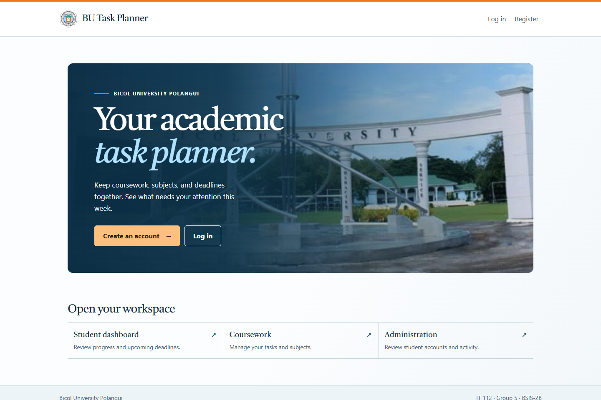

# BU Student Academic Task and Deadline Management System

A coursework planner for Bicol University Polangui. Students organize assignments by subject, deadline, priority, and progress. Administrators review activity and manage eligible student accounts.

**IT 112 · Group 5 · BSIS-2B · Week 16**

[Open the live planner](https://bu-task-planner-group5.onrender.com/) · [Final project report](docs/phase7/Phase-7-Final-Report.pdf) · [Submission tag](https://github.com/kjamesss/final-project-Group5TaskManagementSystem-BSIS2b/tree/phase-7-final) · [Release tag](https://github.com/kjamesss/final-project-Group5TaskManagementSystem-BSIS2b/tree/v1.0-final)



## Using the planner

1. Choose **Create an account** and register with a name, email, and password. Registration opens the login page and confirms that the account is ready. A successful login opens the dashboard automatically.
2. In **Tasks**, choose **New subject**, give it a name, and optionally select a display color. Choose **New task** to enter a title and deadline, then assign a subject, priority, status, and optional description.
3. Open **Dashboard** for status totals and incomplete work due today through seven days ahead or already overdue. Select a deadline to find that assignment in the task list. Dates use Manila time.
4. Search by keyword or combine subject, status, and priority filters. Use **Edit** to update a record. **Delete** names the selected item and asks for confirmation. Removing a subject preserves its assignments as uncategorized.
5. Use the workspace navigation to open **Add a task**, **Dashboard**, **Tasks**, or **Profile**. Use **Profile** to update a name or email. Administrators can search the account directory, edit student accounts, delete students with no coursework or subjects, and review recorded tasks.

## Run locally

Install Node.js 24 LTS, npm, and either a local MongoDB server or access to MongoDB Atlas. From the repository root:

```sh
npm ci
node -e "require('node:fs').copyFileSync('.env.example','.env',require('node:fs').constants.COPYFILE_EXCL)"
node -e "console.log(require('node:crypto').randomBytes(48).toString('hex'))"
```

Set `JWT_SECRET` in the new `.env` to the generated value. Set `MONGODB_URI` to the application database, including its name. The example uses a MongoDB service at `127.0.0.1:27017`. Then run:

```sh
npm start
```

Open [localhost:3000](http://localhost:3000/) or the port you configured. The server serves the frontend and API from the same origin. `npm run dev` restarts it after server-side changes. A separate Live Server on port 5500 can use the example’s allowed origins for development.

| Setting | Purpose |
| --- | --- |
| `MONGODB_URI` | Database URI with an explicit database name. Provided privately to Render. |
| `JWT_SECRET` | Random server-only signing key of at least 32 characters. Render generates its own. |
| `PORT` | HTTP port, default 3000 locally and platform-assigned on Render. |
| `FRONTEND_ORIGINS` | Optional comma-separated list of permitted additional frontend origins. |
| `NODE_ENV` | Set to `production` on Render for HTTPS-only cookies and public port binding. |

New registrations receive the student role. A database manager can provision an administrator by verifying a registered account in the intended database and assigning its `role` to `admin`. There is no shared administrator login in the repository.

## Architecture and API

Bootstrap 5, HTML, CSS, and vanilla JavaScript run in the browser. Fetch requests reach Express. Mongoose reads and writes the `users`, `categories`, and `tasks` collections. The server hashes passwords with bcrypt and signs an eight-hour session carried in an HttpOnly cookie. Task and subject writes are scoped to the signed-in owner. Related writes are serialized per owner within a single server process. The deployed configuration uses one instance.

| Route | Operation |
| --- | --- |
| `GET /api/health` | Database readiness, HTTP 200 or 503 |
| `POST /api/users`, `POST /api/login`, `POST /api/logout`, `GET /api/session` | Register, sign in, sign out, inspect the signed-in profile |
| `GET, POST /api/tasks` and `PUT, DELETE /api/tasks/:id` | List, create, update, or delete personal assignments |
| `GET, POST /api/categories` and `PUT, DELETE /api/categories/:id` | Manage subjects and clear references when removing one |
| `PUT /api/users/:id` | Edit own profile or, as an administrator, a student profile |
| `GET /api/users`, `GET /api/admin/tasks`, `DELETE /api/users/:id` | Administrator directory, task oversight, eligible account deletion |

## Verification and deployment

Run `npm test` for the 15 integration tests. They launch a temporary MongoDB process and inspect stored records. The first run may download the MongoDB binary.

Run `npm run test:browser` against a running copy. Set `CHROME_PATH` to your Chrome or Chromium executable and `QA_BASE_URL` to the exact app origin if it differs from the local default. Set `MONGODB_URI` to **that same app’s database** for ID-based readback. The suite creates uniquely named student and administrator fixtures and removes them after the run. Set `QA_EVIDENCE` to an output directory to save screenshots and results.

- [Integration test output](docs/phase7/integration.tap)
- [Local browser and database checks](docs/phase7/local/results.json)
- [Live Render and Atlas checks](docs/phase7/live/results.json)
- [Render deployment screenshot](docs/phase7/render-deploy.jpg)

The [Render Blueprint](render.yaml) deploys a free Node web service in Singapore from `main`, installs production dependencies with `npm ci --omit=dev`, and runs `npm start`. The Blueprint prompts for `MONGODB_URI` during setup. Allow the service to reach Atlas in the cluster’s network settings. Render supplies the public origin and checks [API readiness](https://bu-task-planner-group5.onrender.com/api/health). An idle free service can take a little time to wake.

## Contributors

| Member | Project role |
| --- | --- |
| Bea Roshan O. Pabilona | Project manager and documentation officer |
| Eleanor Aimee O. Reantaso | Frontend developer and frontend manager |
| Christian A. Balauro | Backend developer and backend manager |
| Simranjit S. Singh | Database manager |
| Karl James M. Matias | GitHub manager and release coordinator |

The [approved proposal and diagrams](docs/planning/Phase_1_BU_Student_Academic_Task_and_Deadline_Management_System.pdf) define the student/admin roles and three-collection model. The final application continues the [Phase 6 implementation](https://github.com/kjamesss/Phase-6-Update-and-Delete-Functionalities/tree/776c790). The final report includes the phase history, test results, team reflections, and a defense walkthrough.
